<div align="center">


# MarksFlow — Academic Evaluation & Continuous Assessment System
### Institutional Internal Marks Compilation, Best-of-N Normalization & Governance Platform

**Symbiosis Institute of Technology (SIT), Nagpur**  
*Symbiosis International (Deemed University) — Re-accredited by NAAC with 'A++' Grade*

[](https://react.dev/)
[](https://vitejs.dev/)
[](https://fastapi.tiangolo.com/)
[](https://www.python.org/)
[](https://www.sqlite.org/)
[](https://openpyxl.readthedocs.io/)
[](https://opensource.org/licenses/MIT)

</div>

---

## 📌 Executive Overview

**MarksFlow** is a university-grade internal assessment compilation, normalization, and academic governance system built specifically for **Symbiosis Institute of Technology (SIT), Nagpur**. 

Unlike standard Learning Management Systems (e.g. Moodle, Canvas) that lack complex multi-tiered evaluation governance, MarksFlow automates university-specific **Best-of-N written test normalization**, **weighted multi-component compilation**, **medical absence recovery**, and **two-way Excel synchronization** with tamper-evident audit trails and a dedicated student grievance portal.

The platform is pre-seeded with real institutional data:
- **346 B.Tech CSE Batch 2026–30 First-Year Students** across all 5 sections (A, B, C, D, E) with official 11-digit PRNs and university email IDs.
- **28 Verified SIT Faculty & Academic Leadership Profiles** with research dossiers and patents.
- **61 Syllabus Courses** extracted from official SIT curriculum guidelines.
- **4,813 Live Evaluated Marks Entries** including exact continuous assessment marks for **THM6144: Indian Knowledge Systems (CA-1)**.

---

## 🖼️ Feature Walkthrough & Screenshots

Below is an exhaustive walkthrough of every major subsystem in **MarksFlow**, paired with actual system screenshots from the application:

---

### 1. Unified Authentication & Dual-Username Access Portal
<div align="center">
  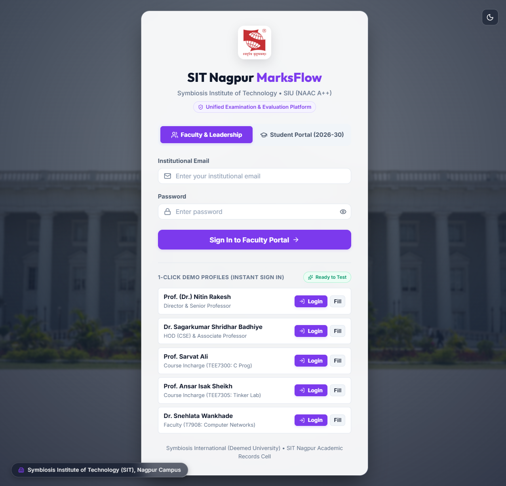
</div>

- **Dual-Persona Architecture**: Seamlessly toggles between the **Faculty & Academic Leadership Portal** and the **Student Portal (Batch 2026–30)**.
- **Dual-Username Resolution**: First-year students can sign in using **either** their official 11-digit PRN (e.g., `26070521001` to `26070521358`) or their university email ID formatted as `firstname.lastname.batch2026@sitnagpur.siu.edu.in`.
- **1-Click Instant Sign-In Badges**: Quick-fill credentials for Director Prof. (Dr.) Nitin Rakesh, HOD Dr. Sagarkumar Badhiye, Course Incharges, and representative students from Sections A through E (including Nitinkumar Sah, Disha Aher, and Vishesh Dawande).
- **Aesthetic Glassmorphic UI**: Ultra-clean frosted glass card backed by the high-resolution Symbiosis Institute of Technology Nagpur landmark campus photography.

---

### 2. Consolidated Master Sheet & Live Best-of-N Normalization
<div align="center">
  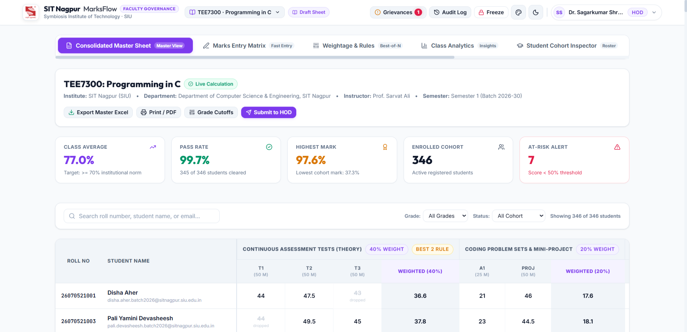
</div>

- **Real-Time Institutional KPIs**: Instant computation of **Class Average (77.0%)**, **Pass Rate (99.7% — 345 of 346 cleared)**, **Highest Score (97.6%)**, **Enrolled Cohort (346 active students)**, and **At-Risk Alerts (7 students < 50% threshold)**.
- **Automatic Best-of-N Derivation**: When a course specifies "Best 2 of 3 Tests", the calculation engine evaluates all 3 scores in real time, automatically drops the lowest attempt (e.g. `43 dropped` for Disha Aher, `44 dropped` for Pali Yamini Devasheesh), and accurately computes the normalized weighted percentage contribution (40%).
- **Multi-Group Aggregation**: Seamlessly combines Continuous Assessment Tests (40%), Coding Problem Sets & Mini-Projects (20%), and Practical Lab Vivas (40%) to derive the final 100-point internal grade.
- **Executive Actions**: One-click **Export Master Excel**, **Print / PDF**, **Grade Cutoffs Tuning**, and **Submit to HOD**.

*(Below: Consolidated Master Sheet for upper-semester course **T7908: Computer Networks**, displaying 45 enrolled students, 79.1% class average, and real-time Best-2 CIE test tracking)*:
<div align="center">
  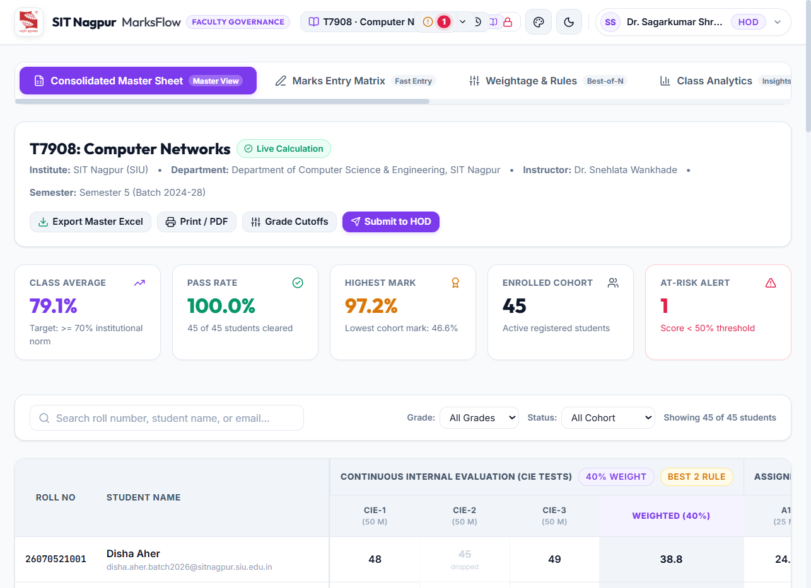
</div>

---

### 3. Assessment Architecture & Evaluation Rule Builder
<div align="center">
  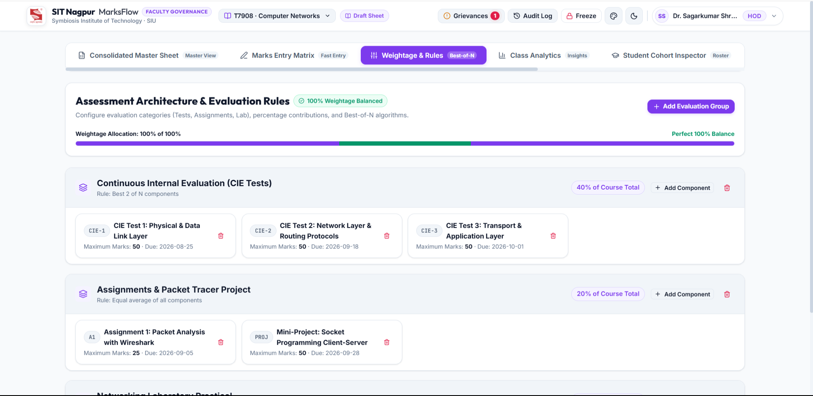
</div>

- **Mathematical Weightage Balancing**: Dynamic progress bar provides instant visual validation ensuring total course weightages equal **100% of 100% (Perfect 100% Balance)**.
- **Configurable Rule Types**:
  - `Best N of M Components`: Automatically keeps top $N$ scoring assessments and drops the rest.
  - `Equal Average`: Computes arithmetic mean across all assignments or quizzes.
  - `Direct Sum`: Aggregates raw marks directly (ideal for continuous lab logs + end-term viva voce).
- **Component Administration**: Easily add assessment groups, define maximum marks, assign due dates, and configure component codes (`CIE-1`, `CIE-2`, `CIE-3`, `A1`, `PROJ`, `LAB`).

---

### 4. Student Cohort Drilldown & Report Card Inspector
<div align="center">
  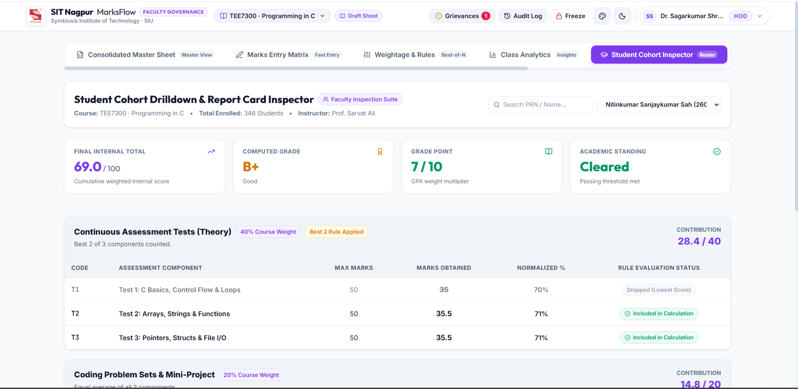
</div>

- **Comprehensive Individual Audit**: Search by student PRN, roll number, or name to inspect individual score cards.
- **Detailed Evaluation Trace**:
  - Displays student **Nitinkumar Sanjaykumar Sah (PRN `26070521143`, Section C)**.
  - Final Internal Total: **69.0 / 100**, Computed Grade: **B+ (Good)**, Grade Point: **7 / 10 (GPA Multiplier)**, Academic Standing: **Cleared**.
  - Highlights exact component status: `T1: 35/50 (70%) -> Dropped (Lowest Score)`, `T2: 35.5/50 (71%) -> Included in Calculation`, `T3: 35.5/50 (71%) -> Included in Calculation`.
  - Continuous Assessment Tests contribute **28.4 / 40 points**; Mini-Project contributes **14.8 / 20 points**.

---

### 5. Student Transparency Portal (Direct Student Experience)
<div align="center">
  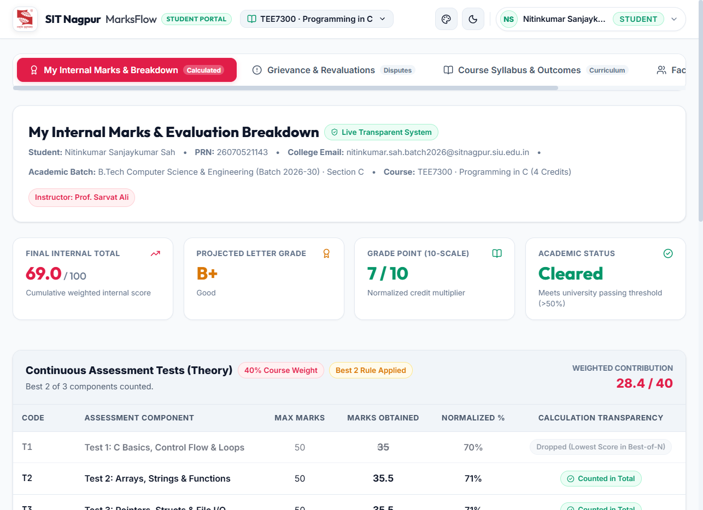
</div>

- **No More Hidden Formulas**: Students see the exact mathematical derivation of their internal marks.
- **Verified Credentials Display**: Header confirms student name, official PRN (`26070521143`), college email (`nitinkumar.sah.batch2026@sitnagpur.siu.edu.in`), section (`Section C`), and course instructor (`Prof. Sarvat Ali`).
- **Calculation Transparency Tags**: Clear visual badges indicate whether a test was `Counted in Total` or `Dropped (Lowest Score in Best-of-N)` so students understand why a lower score was excluded.

*(Below: Full panoramic student view showing theory assessments, coding problem sets, practical lab vivas, and the direct in-page grievance filing panel)*:
<div align="center">
  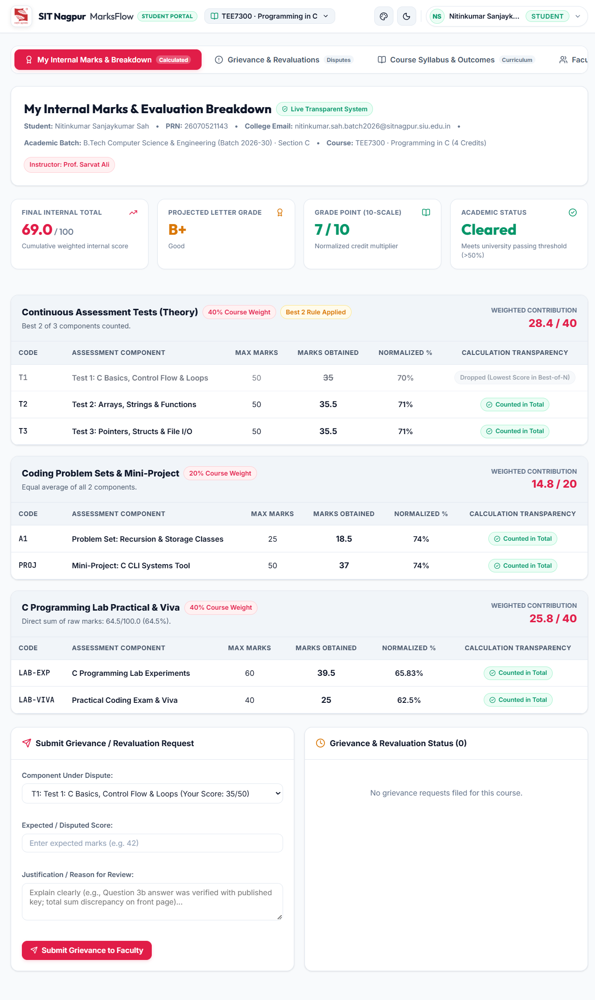
</div>

---

### 6. Student Grievance & Academic Revaluation Lifecycle
<div align="center">
  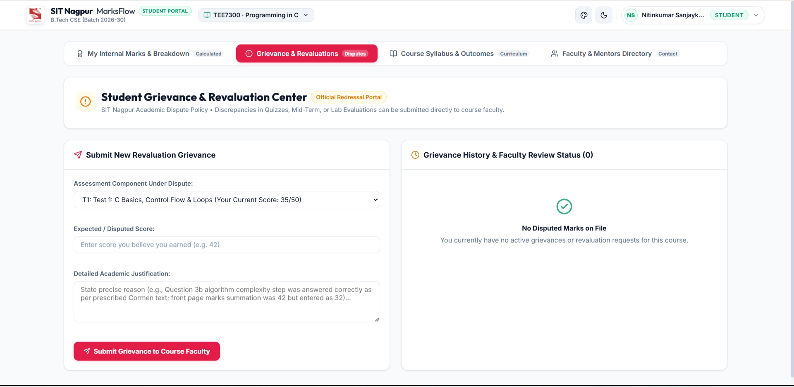
</div>

- **Student Grievance Center**: Students select any contested assessment component, specify their claimed score, provide academic rationale, and submit directly to the course teacher.
- **Faculty Review & Adjudication**:
<div align="center">
  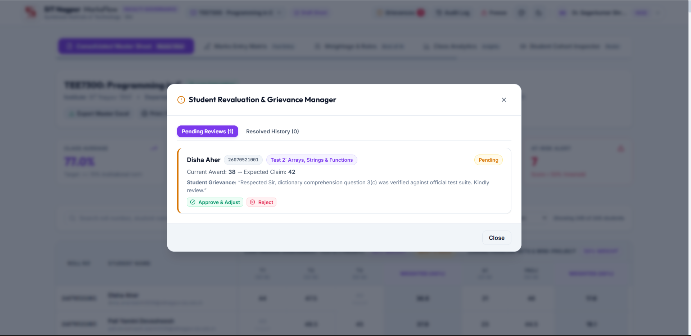
</div>

- **Full Transparency**: Teachers review the student's request (e.g. *Disha Aher, PRN 26070521001, Test 2: Arrays, Strings & Functions — Current Award: 38 -> Expected Claim: 42*).
- **1-Click Resolution**: Faculty click `[Approve & Adjust]` to immediately update the score across the database and consolidated sheets, or `[Reject]` with comments. Every approval generates a timestamped entry in the audit trail.

---

### 7. Official SIT Nagpur Curriculum & Syllabus Explorer
<div align="center">
  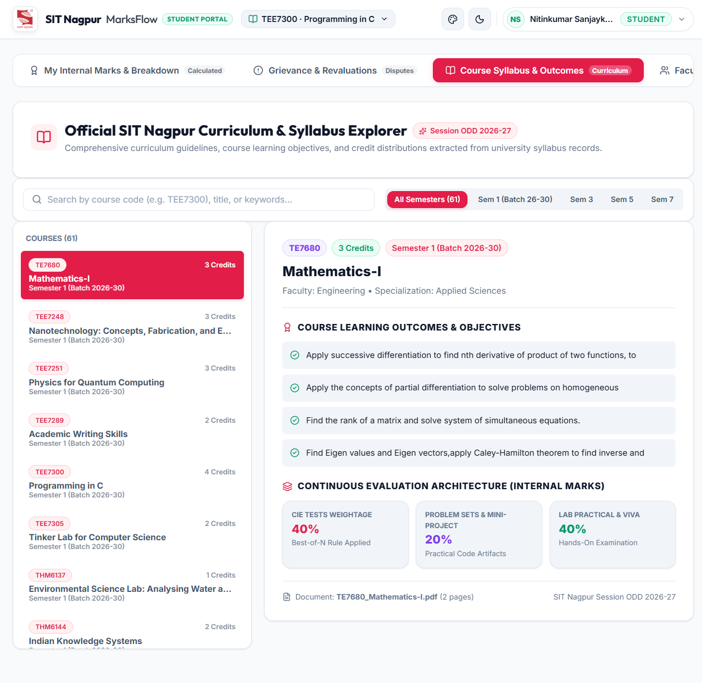
</div>

- **61 Syllabus Courses Catalog**: Extracted directly from official SIT Nagpur departmental documents for Semester 1 (Batch 2026–30), Semester 3, Semester 5, and Semester 7.
- **Comprehensive Course Dossiers**: Browse course learning outcomes, credit distributions (e.g., Mathematics-I: 3 Credits, Programming in C: 4 Credits, Tinker Lab: 2 Credits), and official continuous evaluation weightages.

---

### 8. Faculty & Academic Leadership Directory
<div align="center">
  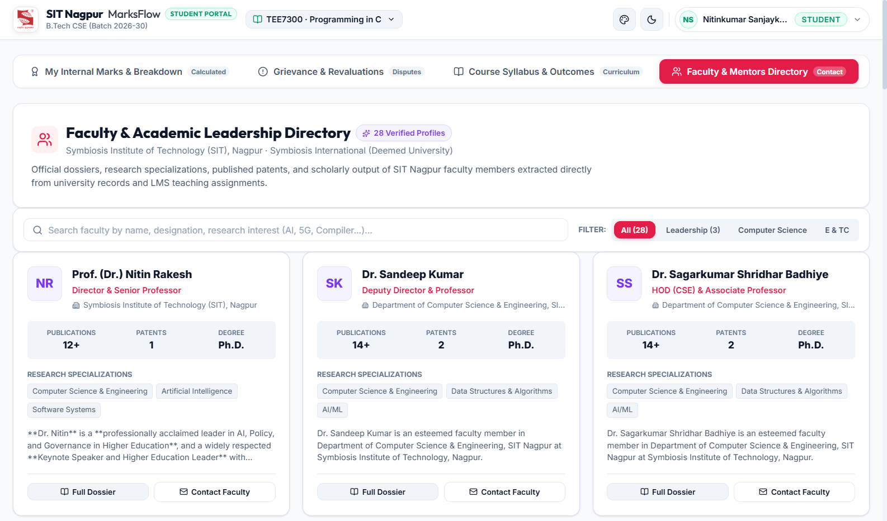
</div>

- **28 Verified Institutional Profiles**: Detailed academic dossiers for SIT Nagpur faculty, including Director Prof. (Dr.) Nitin Rakesh, Deputy Director Dr. Sandeep Kumar, HOD Dr. Sagarkumar Badhiye, and course incharge professors.
- **Scholarly Credentials**: Displays publication counts, patent records, highest academic degrees (Ph.D.), research specializations (AI/ML, 5G, Distributed Systems), and direct mentorship channels.

---

### 9. Curated Aesthetic Theming & Accessibility Suite
<div align="center">
  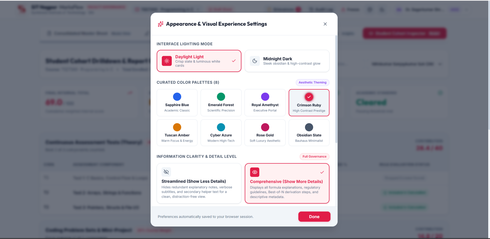
</div>

- **8 Curated Color Palettes**: `Sapphire Blue`, `Emerald Forest`, `Royal Amethyst`, `Crimson Ruby`, `Tuscan Amber`, `Cyber Azure`, `Rose Gold`, and `Obsidian Slate`.
- **Lighting Modes**: High-contrast **Daylight Light** mode and sleek **Midnight Dark** mode.
- **Information Clarity Density**:
  - *Streamlined (Show Less Details)*: Eliminates secondary text, badges, and helper banners for maximum grading speed and zero clutter.
  - *Comprehensive (Show More Details)*: Displays all regulatory guidelines, calculation formulas, and descriptive metadata.

---

## 🏛️ Ingested Institutional Dataset

| Institutional Category | Verified Count | Details & References |
| :--- | :---: | :--- |
| **First-Year Enrolled Students** | **346** | Full Batch 2026–30 across Sections A (68), B (70), C (69), D (70), and E (69) with 11-digit PRNs (`26070521001` – `26070521358`). |
| **Faculty & Leadership Profiles** | **28** | SIT departmental leaders (Director, Deputy Director, HOD, Course Incharges). |
| **Curriculum Courses** | **61** | Extracted from SIT Nagpur Session ODD curriculum records. |
| **Total Marks Evaluated** | **4,813** | Continuous tests, problem sets, lab experiments, and practical vivas. |
| **Official CA-1 Marks** | **346** | Ingested directly from official SIT university documents for `THM6144: Indian Knowledge Systems`. |

---

## 🛠️ Technology Stack

- **Frontend**:
  - React 19 (Hooks, Context, Functional Component Architecture)
  - Vite 8 (Ultra-fast HMR and bundle optimization)
  - Lucide React Icons
  - Pure Vanilla CSS (Curated HSL variables, fluid glassmorphism, responsive flex/grid layouts)
- **Backend**:
  - FastAPI (Python 3.12, High-concurrency async REST API)
  - Uvicorn (ASGI Production Server)
  - Pydantic v2 (Strict type checking and request validation)
  - OpenPyXL (Multi-sheet Excel workbook builder with embedded formulas)
  - SQLite (WAL mode, ACID-compliant transactions, foreign key cascade constraints)
  - PyPDF (Official university records ingestion)

---

## 🚀 Local Installation & Quick Start

### Prerequisites
- **Node.js** (v18.0 or higher)
- **Python** (v3.10 or higher)
- **Git**

---

### Step 1: Clone Repository
```bash
git clone https://github.com/<your-username>/internal-marks-system.git
cd internal-marks-system
```

---

### Step 2: Backend Setup
```bash
cd backend

# (Optional) Create Python virtual environment
python3 -m venv venv
source venv/bin/activate   # On Windows: venv\Scripts\activate

# Install required packages
pip install -r requirements.txt

# Run system verification test suite (tests calculations & Best-of-N logic)
python test_system.py

# Start the FastAPI server
uvicorn main:app --host 0.0.0.0 --port 8000 --reload
```
*API Swagger Documentation is live at `http://localhost:8000/docs`.*

---

### Step 3: Frontend Setup
```bash
cd ../frontend

# Install dependencies
npm install

# Start Vite development server
npm run dev -- --host 0.0.0.0 --port 3000
```
Open **`http://localhost:3000`** in your browser.

---

### 🔑 Instant Demo Accounts for Testing

| Role | Name | Username / PRN | University Email |
| :--- | :--- | :--- | :--- |
| **Director** | Prof. (Dr.) Nitin Rakesh | `director@sitnagpur.siu.edu.in` | `director@sitnagpur.siu.edu.in` |
| **HOD (CSE)** | Dr. Sagarkumar Badhiye | `hod.cse@sitnagpur.siu.edu.in` | `hod.cse@sitnagpur.siu.edu.in` |
| **Faculty (C Prog)** | Prof. Sarvat Ali | `sarvat.ali@sitnagpur.siu.edu.in` | `sarvat.ali@sitnagpur.siu.edu.in` |
| **Student (Sec A)** | Disha Aher | `26070521001` | `disha.aher.batch2026@sitnagpur.siu.edu.in` |
| **Student (Sec B)** | Anuj Sanju Agrawal | `26070521091` | `anuj.agrawal.batch2026@sitnagpur.siu.edu.in` |
| **Student (Sec C)** | Nitinkumar Sah | `26070521143` | `nitinkumar.sah.batch2026@sitnagpur.siu.edu.in` |
| **Student (Sec D)** | Vishesh Dawande | `26070521181` | `vishesh.dawande.batch2026@sitnagpur.siu.edu.in` |
| **Student (Sec E)** | Zaima Wasiq Ur Rahim | `26070521241` | `zaima.rahim.batch2026@sitnagpur.siu.edu.in` |

*(Password for demo accounts: any password or click the 1-Click login badges directly on the sign-in screen).*

---

## 📂 Repository Directory Layout

```text
internal-marks-system/
├── backend/
│   ├── calculation_engine.py      # Core Best-of-N, grading & weighted sum algorithms
│   ├── database.py                # SQLite WAL connection & schema migrations
│   ├── excel_service.py           # Multi-sheet Excel export & ingestion parser
│   ├── main.py                    # FastAPI REST routes & authentication
│   ├── seed_data.py               # Comprehensive database seeder
│   ├── test_system.py             # System verification test suite
│   ├── requirements.txt           # Python dependencies
│   ├── students_data.json         # 346 verified Batch 2026-30 student records
│   ├── faculty_profiles_full.json # SIT departmental leadership dossiers
│   └── marks_system.db            # Pre-seeded SQLite database
├── frontend/
│   ├── src/
│   │   ├── components/
│   │   │   ├── LoginScreen.jsx             # Persona selector & dual username auth
│   │   │   ├── Navbar.jsx                  # Top navigation & session controls
│   │   │   ├── MarksEntryMatrix.jsx        # Grid evaluation & real-time input
│   │   │   ├── ConsolidatedMasterSheet.jsx # Master grade sheet with Excel sync
│   │   │   ├── StudentPortal.jsx           # Student breakdown & grievance view
│   │   │   ├── StudentGrievanceCenter.jsx  # Faculty revaluation management
│   │   │   ├── WeightageArchitect.jsx      # Assessment rules & weightage builder
│   │   │   ├── ClassAnalytics.jsx          # Grade distributions & histograms
│   │   │   ├── FacultyDirectory.jsx        # Teacher profiles & academic dossiers
│   │   │   ├── AppearanceModal.jsx         # 8 color themes & animation toggles
│   │   │   └── LockModal.jsx               # Audit lock & submission dialogue
│   │   ├── App.jsx                         # Main application state & routing
│   │   └── index.css                       # Modern CSS design system
│   ├── package.json
│   └── vite.config.js
├── images/                                # Project screenshots & emblems
│   ├── 01_login_portal.png
│   ├── 02_consolidated_master_sheet.png
│   ├── 03_weightage_rules_architect.png
│   ├── 04_student_cohort_inspector.png
│   ├── 05_faculty_grievance_manager.png
│   ├── 06_student_marks_breakdown.png
│   ├── 07_student_portal_full_view.png
│   ├── 08_student_grievance_submission.png
│   ├── 09_curriculum_syllabus_explorer.png
│   ├── 10_faculty_directory_dossiers.png
│   ├── 11_appearance_theme_settings.png
│   ├── 12_computer_networks_sheet.png
│   └── sit_logo.png
├── HACKATHON_DEFENSE_GUIDE.md             # 25 Evaluator Q&As & technical defense script
├── .gitignore                             # Clean git ignore rules
└── README.md                              # This documentation file
```

---

## 🧪 Verification & Automated Testing

Run the automated mathematical calculation suite:
```bash
cd backend
python test_system.py
```

Expected Output:
```text
✓ Found T7908: Computer Networks (45 enrolled, status: draft)
✓ Total configured weightage: 100.0% (is_valid_100: True)
✓ Checking Malugu Rohit Satya Brahmacharya Best-of-N Rule:
  - CIE-1: 26.0/50.0 (52.0%) -> DROPPED
  - CIE-2: 41.0/50.0 (82.0%) -> COUNTED
  - CIE-3: 43.0/50.0 (86.0%) -> COUNTED
✓ Arithmetic check passed: (82.0% + 86.0%) / 2 = 84.0% -> Contributes 33.6/40.0 points!
✓ Manish Sahu medical absence properly dropped: CIE-2 Absent was excluded; top 2 tests counted.
✓ Generated Excel Workbook sheets: ['Consolidated Internal Marks', 'Grade Analytics', 'Audit Trail Log']
==========================================
ALL TESTS PASSED WITH 100% CALCULATION ACCURACY!
==========================================
```

---

## 📜 Regulatory & Institutional Standards

- **UGC & AICTE Directives**: Implements continuous evaluation and internal assessment mandates for undergraduate technical education.
- **Symbiosis International (Deemed University)**: Built around official SIU relative & absolute letter grading brackets (O, A+, A, B+, B, C, P, F).
- **NAAC Criteria II Compliance**: Immutable RFC-3339 audit logs provide complete transparency and tamper-evident history for NAAC peer-review visits.

---

<div align="center">
Designed & Developed for <strong>Symbiosis Institute of Technology (SIT), Nagpur</strong>  
Batch 2026–30 Academic Evaluation & Marks Governance Platform
</div>
